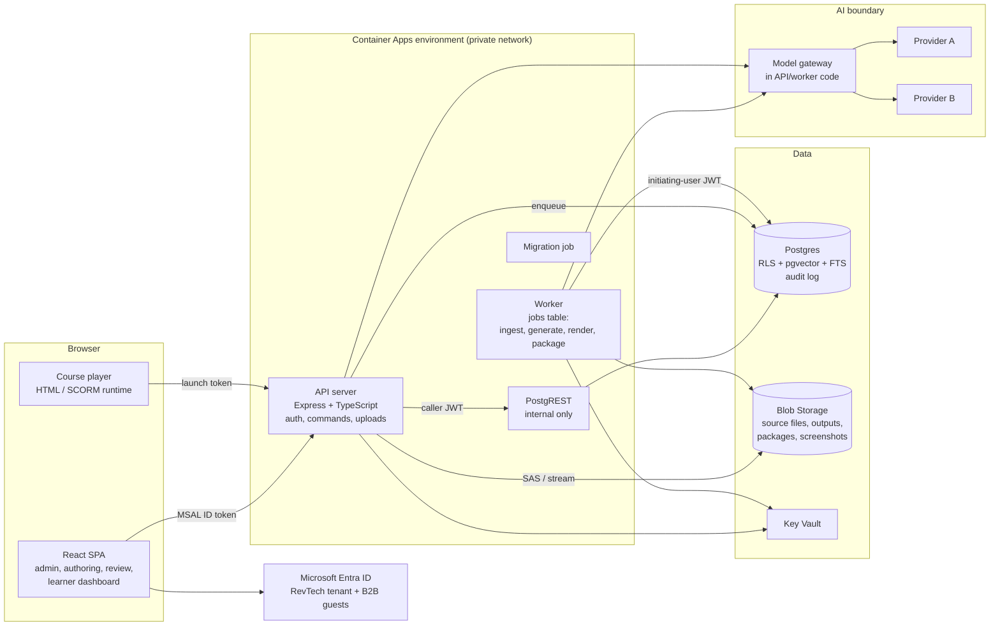

# 01 · Product Architecture and Technology Stack

Covers master-prompt §36 items 3–4 (architecture, stack) and §33 (technical architecture expectations).
Read [README.md](README.md) first for the decisions this builds on.

## Starting point

The repo today is a single-organization compliance LMS that is being retired. What carries over:

| Keep | Why |
|---|---|
| React 19 + Vite + TypeScript + Tailwind + Radix UI on the front end | Radix gives accessible primitives (focus management, keyboard, ARIA) that §30 needs; the team already knows the stack. |
| Express API that verifies the Microsoft ID token and mints a short-lived JWT for PostgREST | Every database read runs *as the caller*, so Postgres row-level security (RLS) is the isolation boundary, not application code. This is the single most important property for §4 and §14 ("the AI inherits the initiating user's permissions"). |
| PostgREST behind the API, internal ingress only | Cheap, RLS-native CRUD for the many simple screens. |
| Postgres migrations applied by a Container Apps job; GitHub Actions deploy with OIDC | Works today; no stored secrets. |
| Security-definer RPCs for anything a user must not be able to fake (scoring, state transitions) | Pattern from `submit_attempt`; extended to approvals, publication, promotions. |

What does not carry over: the schema (single `admin`/`employee` role, no client dimension), the modules/quiz tables, and the compliance data. The new schema starts at a fresh migration series (see [02-data-model.md](02-data-model.md)).

## Architecture at a glance

### The four runtime pieces

1. **API server** (`server/`). Verifies Microsoft tokens, resolves the caller's profile, and exposes two kinds of endpoint:
   - `/api/db/*` – the existing PostgREST pass-through, for reads and simple writes governed entirely by RLS.
   - `/api/v1/*` – **command endpoints** for anything with workflow, files, or AI: upload, start generation, submit for review, approve, publish, promote, assistant questions. Each command validates input (zod), checks permission through a database function, writes an audit event, and either does the work or enqueues a job.
2. **Worker** (`worker/`, same image, different start command, its own Container App). Runs background jobs from a Postgres-backed queue (the `jobs` table, `db/migrations/00101`): source extraction, chunking and embedding, duplicate detection, coverage/readiness recalculation, generation pipelines, output rendering, packaging, change-impact scans. Scales on queue depth.
3. **PostgREST** – unchanged role.
4. **Course player** – a static, pre-built bundle that renders a published course from its content model. The same bundle is embedded in the platform's learner experience *and* zipped into Standalone HTML / SCORM packages, so there is one implementation of the interactive patterns.

### Why a worker and a Postgres queue (not Service Bus, not Functions)

Generation runs for minutes, calls models many times, and must survive restarts. A jobs table in Postgres keeps jobs in the same database as the data they act on, so a job and the rows it creates commit together, there is no new service to secure or move to Azure Government, and job status is just a table the UI can read through RLS. At the year-one scale (≤50 clients, ≤10,000 learners) Postgres handles this comfortably. Revisit if job throughput or fan-out outgrows a single database.

*Changed during Phase 0:* the design first named the pg-boss library. A small `jobs` table of our own (claim with `FOR UPDATE SKIP LOCKED`, retry with backoff, reclaim abandoned jobs) was used instead, because jobs then sit under the same RLS as everything else, people can only create them through permission-checked commands, and the worker needs no rights beyond three functions. Scheduling (reminders) will be a `run_after` in the future, enqueued by a daily job.

## How tenant isolation works

Decision so far: **not final**, so the design is row-level now and portable later.

- Every client-owned row carries `client_id`. Global and Shared/Restricted content lives in the same tables with `client_id null` and a `scope` column.
- RLS policies on every table answer "may this caller see this row" from **memberships**, never from what the UI says the active client is. The active client in the UI is a filter and a safety prompt, not a security control.
- Workers act **as the initiating user**: a job stores `requested_by`, and the worker mints the same short-lived JWT the API would, then runs its queries through it. That is how "the AI cannot use a source the user cannot access" is enforced by Postgres, not by prompt code.
- Blob paths are `clients/{client_id}/…` or `global/…`. The browser never gets a container-wide credential: uploads and downloads go through the API (or a single-blob, short-lived SAS the API issues after an RLS check).
- Vector search and full-text search run *inside* Postgres, so the same RLS policies filter search results. No separate search index can drift out of sync with permissions. This is the main reason not to start with an external search service.
- **Portability:** because client data is keyed by `client_id` and global content is separable, a per-client export/import tool can lift one client into a dedicated deployment (its own database, storage, and AI provider) later, with the Global library replicated read-only. Infrastructure moves from `infra/provision.sh` to Bicep so a second deployment is a parameter file, not a hand-run script.

## Technology stack

| Concern | Choice | Rationale / trade-off |
|---|---|---|
| Front end | React 19, Vite, TypeScript, Tailwind, Radix UI, TanStack Query, React Router | Existing. Radix for accessibility. Add **TipTap** (ProseMirror) for the rich-text/structured editor in the editing and review workspaces – it supports comment anchors and tracked changes via marks. |
| API | Node 20+, Express 5, **converted to TypeScript**; zod for request validation; OpenAPI generated from the zod schemas | Server grows from ~150 lines to the core of the product; types shared with the web app (`packages/contracts`) prevent drift. OpenAPI covers the §35 "API specification" deliverable. |
| Database | Azure Database for PostgreSQL Flexible Server, with `pgvector` and built-in full-text search | RLS is the isolation model. **Move off the Postgres server shared with RevelationHub before any real client data** (see risk register). |
| Queue / jobs | `jobs` table on the same Postgres, claimed with `SKIP LOCKED` | See above. |
| Object storage | Azure Blob Storage, private endpoint, versioning + soft delete on | Source files, rendered outputs, packages, screenshots. Defender for Storage malware scanning on upload; a file stays `quarantined` until the scan result arrives. |
| Search / RAG | Postgres FTS (keyword) + pgvector (semantic), hybrid ranking with reciprocal-rank fusion | Inside the RLS boundary. Adequate at year-one volume. Azure AI Search is the upgrade path if volume or relevance needs it; it would need per-client indexes or security trimming, which is why it's deferred. |
| AI | **Model gateway** in our code with pluggable providers (see below) | Provider is configuration, per your decision. |
| Document extraction | DOCX via `mammoth`, PPTX/XLSX via OOXML parsing (`jszip` + XML; `exceljs` for sheets), PDF text via `pdfjs-dist`; OCR for images and scanned PDFs via an OCR provider behind the same gateway rules | Open-source parsers keep client files inside our boundary. OCR is an external service call, so it's subject to the same classification rules as model calls. |
| Output rendering | DOCX: `docx`; PPTX: `pptxgenjs` (native text boxes, tables, images, speaker notes – nothing flattened to images); HTML: the course player; PDF: headless Chromium (Playwright) printing the HTML job aid | All editable formats, per §20. Chromium also runs the automated accessibility check (axe-core) before publication. |
| Packaging | Our own SCORM 1.2 manifest + runtime shim in the player; Standalone HTML zip | MVP. SCORM 2004 / xAPI / cmi5 later ([06-lms.md](06-lms.md)). |
| Identity | Microsoft Entra ID (RevTech tenant) via MSAL; client users invited as **B2B guests** | Guests receive tokens from the RevTech tenant, so the existing token verification keeps working. Guests' email is in `email`/`upn` rather than `preferred_username` in some cases – handled in `verifyCaller`. MFA is enforced through Entra Conditional Access for both members and guests. |
| Secrets | Key Vault + managed identity | Existing. |
| Observability | Container Apps logs → Log Analytics; Application Insights (OpenTelemetry) for API and worker traces; alerts on job failures, auth failures, RLS denials spikes | |
| Audit | Append-only `audit_events` table (no UPDATE/DELETE grants to anyone but the retention job), streamed to Log Analytics daily | Queryable in-app for client audit history; tamper-resistant copy outside the database. |
| IaC | Bicep, one parameter file per environment | Needed for environment separation (§29) and for the dedicated-deployment option. |
| Tests | Vitest (unit, React Testing Library), **pgTAP-style SQL tests for every RLS policy**, Playwright end-to-end with axe accessibility assertions | Isolation is only as good as its tests; every table gets a "client A cannot see client B" test. |

### The model gateway

One module (`server/ai/`) that every AI call goes through – generation, embeddings, OCR, assistant. It owns:

- **Provider adapters** behind one interface (`complete`, `embed`, `ocr`). Initial adapters: Anthropic API, Claude on AWS Bedrock, Azure OpenAI. Adding one is a file, not a refactor.
- **A provider registry** (Platform Administrator-managed table): endpoint, models, region, whether the provider is approved for `Client Confidential`, whether it is approved for CUI/export-controlled data (all `false` until authorized), and data-retention terms.
- **Per-client policy**: which providers a client allows. A client with none allowed cannot generate.
- **A classification check on every call**: the highest Security Classification among the chunks in the prompt must be within the provider's ceiling *and* the client's allowed list, or the call is refused and logged. This is how §29's "do not transmit CUI … to a public AI model unless expressly authorized" is enforced in code.
- **Logging**: provider, model, version, token counts, latency, the job and manifest it belongs to. Prompts and completions for Client-Specific content are stored with the job in the client's own rows (so they inherit RLS and retention), not in a central log.
- Prompt templates are versioned files in the repo (`server/ai/prompts/`), and their version is written into each Generation Manifest.

## Environments and deployment

| Environment | Purpose | Data |
|---|---|---|
| Local | Front-end dev against a shared preview API, as today, plus a docker-compose Postgres + PostgREST for server and RLS tests | Fictional only |
| Preview (`rg-accelerate-preview`, existing) | Integration and demos | Fictional only (the FI/CO demo client) |
| Staging | Release candidate, separate database, server, and storage | Fictional or client-approved test data |
| Production | Real clients | Real data; **its own Postgres server**, not shared with RevelationHub |

Deployment options (§33): the stack is containers + Postgres + Blob + Key Vault + Entra, all of which have Azure Government equivalents. Before committing to a Government deployment, confirm each specific service and feature (Container Apps, Postgres Flexible with pgvector, Defender for Storage malware scanning, the chosen AI provider) is available in the target Government region – that check is a roadmap item, not an assumption. Client-managed or private-cloud deployment uses the same Bicep templates where the client runs Azure, or the container images plus a Postgres and S3-compatible storage adapter otherwise (not planned before there's demand).

## What changes in the existing code, concretely

| Area | Change |
|---|---|
| `db/migrations/` | Keep `00000` (Supabase compatibility). Archive `00001`–`00006` under `db/migrations/archive/compliance-lms/`, export the old data once to blob storage, and start the platform schema at `00100_*`. The migration runner needs a one-time reset path for the preview database. |
| `server/` | Convert to TypeScript; add `routes/` for command endpoints, `ai/` (gateway), `storage/` (blob), `audit/`, `jobs/` (enqueue). `auth.js` gains guest-email handling and drops the RevTech-only first-sign-in assumption: a guest with no membership gets a profile but sees nothing. |
| `worker/` | New. |
| `web/` | Keep `ui/` primitives, shell, auth. Replace admin/employee areas with context-aware navigation (client switcher + Global/Shared context), and the new screens in [08-screens.md](08-screens.md). The quiz runner and content-block renderer become the seed of the course player. |
| `infra/` | `provision.sh` → Bicep (done in Phase 0: `infra/main.bicep`, `infra/deploy.sh`); storage account and worker app added; Application Insights still to add. |
| `.github/workflows/` | Add test job (unit + RLS + e2e) before deploy; deploy worker alongside API. |
