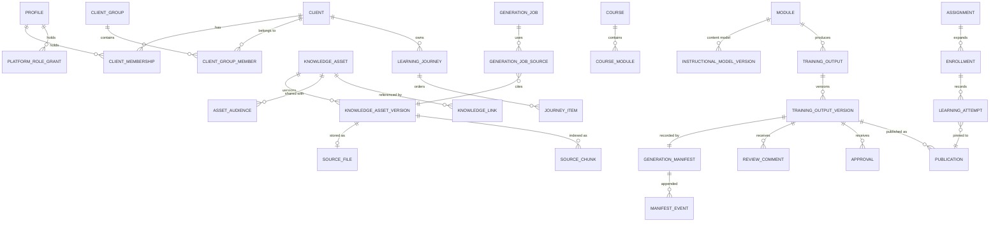

# 02 · Core Data Entities and Relationships

Covers master-prompt §36 item 5 and the §35 "data model" deliverable. Table names are the intended Postgres names; columns listed are the ones that matter for behavior, not every audit column (`created_at`, `updated_at`, `created_by` exist everywhere).

## Conventions

- **`client_id` on every client-owned row.** Nullable only on tables that also hold Global/Shared content, where `scope` says which. A check constraint ties them together: `scope = 'client'` ⇔ `client_id is not null`.
- **Enums as `text` + check constraints**, matching the existing code, so adding a value is a migration without type juggling.
- **Versions are rows, not overwrites.** Anything the spec says is "independently versioned" (§11) has a `*_versions` table; the parent row points at `current_version_id` (and, for outputs, `published_version_id`).
- **Immutable records** (Generation Manifests, audit events, completed attempts) have no UPDATE/DELETE grant for any application role; a trigger rejects changes as a second line of defense.
- **Denormalized security columns** (`client_id`, `scope`, `security_classification`, `ai_use`) are copied onto high-volume child rows such as `source_chunks` so RLS and retrieval filters don't need joins. Triggers keep them in sync with the parent asset.

## Overview

## 1. Identity, tenancy, roles

| Table | Purpose / key columns |
|---|---|
| `profiles` | One per person who has signed in. `email`, `full_name`, `is_active`, `is_guest`, `home_tenant_id`. **No role column** – roles live in the two tables below. |
| `platform_role_grants` | `(profile_id, role)` where role ∈ `platform_admin`, `global_knowledge_admin`. Platform roles grant **no** client-content access by themselves (§3). |
| `clients` | The Client Workspace root. `name`, `slug`, `status` (`setup`, `active`, `archived`), `industry`, `govcon_status`, `sap_landscape` (jsonb: version, deployment model, Fiori config), `dassian_products text[]`, `max_classification` (highest classification this workspace may hold in this environment), `allowed_ai_providers uuid[]`, `branding` (jsonb + logo blob), `accessibility_requirements`, `export_control_notes`. |
| `client_memberships` | `(client_id, profile_id, roles text[])`, roles ⊆ `client_training_admin`, `lms_admin`, `contributor`, `reviewer`, `learner`. One row per person per client; a person can be in several clients. |
| `work_grants` | Narrows Contributors and Reviewers to specific work (§3: "work only within assigned clients, modules, outputs, or knowledge areas"): `(client_id, profile_id, capacity contributor/reviewer, target_type module/output/workstream/asset, target_id)`. A Contributor with no grants can see the workspace shell but no content. |
| `client_groups`, `client_group_members` | Named sets of clients ("Aerospace & Defense", "Dassian clients") used as Shared/Restricted audiences. Managed by Global Knowledge Administrators. |
| `client_workstreams`, `client_business_roles`, `client_terms` | Client setup data: workstreams (FI, CO, …), business roles/personas, and the client glossary (client term → standard SAP term), which generation uses to keep client terminology. |
| `role_training_matrix_versions` | AI-proposed or uploaded business-role → training mapping; `status` must be `approved` by a Client Training Administrator before it drives assignments (§5). |

## 2. Enterprise Knowledge Management

| Table | Purpose / key columns |
|---|---|
| `knowledge_assets` | The governed source. **Five independent dimensions (§7):** `scope` (`global`, `shared`, `client`, `revtech_reference` (Global Knowledge Administrators only, never a client; 00106), `pending_classification`), `security_classification`, `lifecycle_status`, `approval_status`, `ai_use` (`generation`, `reference`, `human_approval_required`, `not_approved`). Plus `export_control_class`, `citation_allowed`, `screenshot_use_allowed`, `authority_tier` (1–10, from §14), `document_type`, tags (`sap_products`, `sap_modules`, `processes`, `fiori_apps`, `transactions`, `dassian_products`, `workstream_ids`, `business_role_ids`), `owner_id`, `source_org`, `source_url`, `effective_on`, `expires_on`, `last_reviewed_on`, `next_review_on`, `current_version_id`, `copied_from_asset_id` (a copy made from a client document by `copy_asset`: the client keeps its own, the copy shares the file and its chunks). Defaults set by the upload command, not the client: from a workspace → `client` / `draft` / `active` / `human_approval_required`; from outside one → `pending_classification`. |
| `asset_audiences` | For `scope = 'shared'`: rows of `client_id` or `client_group_id` the asset is visible to (00106). Set by `place_asset` / `copy_asset`; a Shared asset needs at least one. |
| `knowledge_asset_versions` | `version_no`, `metadata` snapshot (jsonb – metadata is versioned independently of the file, §11), `source_file_id` (null for a metadata-only version), `change_note`, `extraction_status` (`pending`, `running`, `done`, `failed`, `skipped`, `needs_ocr`), `extraction_detail` (what was read, or why not). |
| `source_files` | `blob_path`, `filename`, `mime_type`, `bytes`, `sha256`, `upload_status` (`uploading`, `stored`, `failed`), `scan_status` (`pending`, `clean`, `infected`, `failed`, `not_scanned` – preview only, when `platform_settings.malware_scanning = 'off'`), `uploaded_by`. Written by the API server, which streams the file to Blob and computes size and SHA-256 itself (`start_upload` → `complete_upload`, 00103). One file can back several versions only via explicit "use existing source". |
| `source_chunks` | Retrieval units, written by the worker's readers (`worker/extract/`, 00104). `asset_version_id`, `asset_id`, `client_id`, `ordinal`, `locator` (jsonb: `page`; `slide` + `title`; `sheet` + `range`; `heading` path + `table`/`rows`; `lines` – what a citation points to), `text`, `tsv` (generated, English). RLS follows the asset. Classification, AI use and authority are read from the asset at query time rather than copied, so a reclassified asset can't leave stale chunks behind. `embedding vector`, `embedding_model` arrive with semantic search. Keyword search: `search_library(client, query)`, running as the caller. |
| `extracted_items` | Structured facts pulled from a version (§17): `kind` (`process_step`, `transaction`, `fiori_app`, `field`, `business_rule`, `warning`, `prerequisite`, `role`, `exception`, `objective`, `question`), `data` jsonb, `locator`, `chunk_id`. Drives coverage and readiness without re-reading files. |
| `knowledge_links` | Asset ↔ training node (`program`, `journey`, `course`, `module`) without copying (§6). |
| `asset_relationships` | `(from_asset, to_asset, kind)`: `supersedes`, `duplicate_of`, `derived_from`, `promoted_from`. |
| `ai_use_authorizations` | For `human_approval_required` assets: who authorized use, for which job or module, until when. |
| `promotion_requests` | Propose-for-Global workflow (§24): `source_version_id`, `candidate_asset_id` (a separate new asset, original untouched), `findings` (jsonb: detected client names, PII, possible export-controlled terms, screenshots), `required_approvals`, `status`. |

## 3. Training hierarchy

| Table | Purpose / key columns |
|---|---|
| `programs` | Optional top level per client (curriculum). |
| `learning_journeys` | `client_id`, `program_id`, `title`, `audience` (business roles), `status`, versioned via `learning_journey_versions` (§11). |
| `journey_items` | Ordered contents of a journey: `position`, `course_id` **or** `module_id`, `required`, `prerequisite_item_ids`. |
| `courses`, `course_modules` | A course is an ordered set of modules; a module can appear in several courses and journeys. |
| `modules` | `client_id`, `title`, `objectives` (jsonb, stable ids), `workstream_id`, `process`, SAP tags, `risk_class`, `readiness_status`. |
| `instructional_model_versions` | **The shared approved instructional content model** (§20D) for a module: lessons → sections → blocks (text, steps, screenshots, callouts, knowledge checks, scenarios), each block with stable ids and provenance labels and citations. Every output renders from a model version. **Lessons and activities live here, addressable by id**, rather than as tables, in the MVP; they become tables only if lesson-level assignment is needed. |

## 4. Generation, outputs, review

| Table | Purpose / key columns |
|---|---|
| `generation_jobs` | `client_id`, `requested_by`, `module_id`, `requested_outputs text[]`, `config` (audience, level, duration, emphasis, branding, screenshot source, accessibility, assessment settings, language), `status` (the 13 §19 states), `stage_detail`, `warnings`, `error`, `awaiting_input` (questions the pipeline needs a human to answer). Separate from output approval status. |
| `generation_job_sources` | The exact asset **versions** offered to the job, with `use_mode` (`generation` or `reference`) and the `ai_use_authorization_id` where required. |
| `training_outputs` | `client_id`, `module_id`, `output_type` (`job_aid`, `presentation`, `assessment`, `html_course`, `instructor_guide`, `participant_guide`, `simulation`, `knowledge_check`, `lms_package`), `approval_status` (the 11 §22 states), `current_version_id`, `published_version_id`. |
| `training_output_versions` | `version_no`, `model_version_id` it was rendered from, `content` (output-specific editable structure), `files` (rendered blobs: docx/pdf/html/pptx/zip), `origin` (`generated`, `edited`, `reuploaded`, `synchronized`), `diff_from_previous`. |
| `generation_manifests` | One per output version, **immutable**: sources + versions + tiers + use modes, config, providers/models/versions, prompt template versions, initiating user, timestamps, validation results, unresolved conflicts, gap list. |
| `manifest_events` | Append-only continuation of the manifest for what happens after generation: human edits (with diff), review decisions, approvals, publications, synchronizations. Manifest + events = the full §11 record. |
| `assessment_items` | Per assessment output version: `item_type` (MC, multiple response, T/F, matching, sequencing, scenario, simulation), `prompt`, `options`, **`answer_key`**, `explanation`, `objective_id`, `difficulty`, `topic`, `citation`, `remediation`. Answer keys are never readable by learners (only through a scoring function), as today. |
| `review_cycles`, `review_assignments` | A review round on an output version: stage (`contributor`, `sme`, `client`), reviewers, each reviewer's decision (`approve`, `conditional`, `reject`). |
| `review_comments` | `anchor` (block id + text range), `category` (11 §22 categories), `priority`, `required`, `status` (7 §22 states), `assignee_id`, `parent_id` for threads. |
| `approval_rules` | Who must approve, matched by client / workstream / output type / process / risk class / publication destination (§32). |
| `approvals` | Recorded approvals against an output version and rule. Moving to `approved` is a security-definer function that checks all required rules are satisfied. |
| `change_impacts` | Output change-impact findings (§24): trigger (asset version, screen, role, …), affected output version, affected block ids, explanation, status (`open`, `reviewing`, `no_change_needed`, `updated`), `retraining_required`. |

## 5. Coverage and readiness

| Table | Purpose / key columns |
|---|---|
| `scoring_factors` | Global list of Knowledge Coverage and Training Readiness factors (§13, §15) with default weights and whether each is mandatory. |
| `client_scoring_overrides` | Per-client weights and, for readiness, whether a missing factor `blocks` or `warns`. |
| `coverage_snapshots` | `subject_type` (domain, workstream, process, product, role) + `subject_id`, `score`, `components` (each factor: raw evidence count, score, weight), `missing`, `weights_used`, `calculated_at`. The UI shows only what is stored here – nothing is computed for display without its explanation. |
| `readiness_snapshots` | Per module: `status` (6 §15 states), `components`, `blockers`, `warnings`, `calculated_at`. |

## 6. Learning management

| Table | Purpose / key columns |
|---|---|
| `learner_groups`, `learner_group_members` | Per client. Unlike today's groups, assignments to a group stay linked: new members are enrolled automatically. |
| `assignments` | The rule: `client_id`, who (`learner_id`, `learner_group_id`, or `business_role_id`), what (`module_id`, `course_id`, or `journey_id`), `required`, `due_at` or `due_days_after_enrollment`, `recertify_months`, `max_attempts` (null = unlimited; set by the LMS Administrator per assignment), `assigned_by`, `active`. |
| `enrollments` | Materialized per learner × target: `status` (7 §26 states, derived), `due_at`, `completed_at`. Recomputed when an assignment, group, or membership changes. |
| `publications` | An approved output version made available: `destination` (`platform_lms`, `download`, `share_link`, `scorm_1_2`, `standalone_html`), `published_by`, `withdrawn_at`, `allow_new_assignments`. |
| `learning_attempts` | `enrollment_id`, **`publication_id`** (so history always shows exactly which version a learner took, §24/§25), `started_at`, `completed_at`, `score_pct`, `passed`, `answers`, `interactions`, `bookmark`. Immutable once completed. |
| `certificates` | Issued per completed enrollment; rendered PDF in blob storage. |
| `assistant_threads`, `assistant_messages` | Help Assistant history with `mode` (`learner`, `internal`), citations, `answered` flag, `routed_to` when unanswered. |

## 7. Audit and operations

| Table | Purpose |
|---|---|
| `audit_events` | Append-only: `at`, `actor_id`, `acting_as` (role used), `client_id`, `action`, `target_type`, `target_id`, `details`, `request_id`. Written by command endpoints and security-definer functions, never by the browser. |
| `ai_providers` | Model gateway registry ([01-architecture.md](01-architecture.md#the-model-gateway)). |
| `ai_calls` | One row per gateway call, refusals included: provider, model that answered, job, purpose, classification, outcome (`succeeded`, `refused`, `failed`), tokens, latency. Written only by the worker (`record_ai_call`); provider choice by `ai_route()`. Prompt/response bodies are not stored here; they stay with the owning job under the client's RLS. |
| `notifications` | In-app notifications (review assigned, comment on my work, job awaiting input, change impact). |
| `email_outbox` | Queued reminder and notification emails with `template`, `client_id`, recipient, `sent_at`, provider message id; per-client templates and on/off settings live on `clients`. |
| `jobs` | Background work for the worker: `kind`, `client_id`, `requested_by`, `payload`, `status`, attempts and backoff, result. Readable through RLS by the requester and the client's CTAs. |

## What happens to the retired tables

`profiles` is rebuilt without `role`. `modules`, `quiz_questions`, `assignments`, `attempts`, `employee_groups*`, and the `assignment_status`/`quiz_questions_public` views are dropped after a one-time export to blob storage. Their *patterns* survive: the answer-key-hiding view and server-side scoring RPC become the assessment design; the derived-status view becomes `enrollments` status logic.
