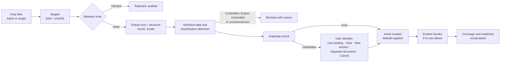
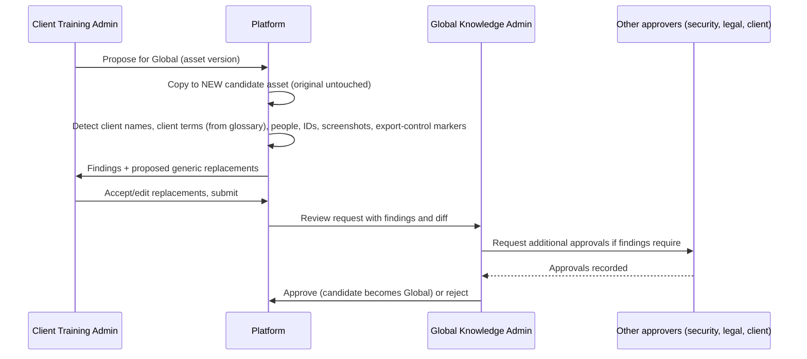

# 04 · Component 1: Enterprise Knowledge Management System

Covers master-prompt §6–§13 and §24 (promotion), and the knowledge-side user journeys. The source-governance model the master prompt requires before coding (§36) is this document plus the AI-use rules in [05-content-generator.md](05-content-generator.md#ai-grounding-and-validation-strategy).

## The libraries

| Library | Who curates | Who can read | Typical content |
|---|---|---|---|
| Global | Global Knowledge Administrators | Members of any client (for reference and generation), plus GKAs | Standard S/4HANA and Fiori docs, approved Dassian docs, FAR/DFARS references where licensed, generic process content, templates, instructional-design and accessibility standards, generic demo screenshots, standard objectives |
| Shared/Restricted | Global Knowledge Administrators | Members of clients in the asset's audience | A&D-specific practices, Dassian-client material, GovCon-only content |
| Client-Specific | That client's Client Training Administrators (Contributors within grants) | Members of that client only | BPDs, test scripts, screenshots, configuration, custom transactions, terminology, roles, policies, existing training |
| Pending Classification | Global Knowledge Administrators | GKAs and the uploader | Anything uploaded outside a client workspace, until classified. **Never available to AI.** |

The "Enterprise Knowledge Library" is not a separate store. It is the union a user can see: Global + their clients' allowed Shared + their clients' Client-Specific, presented as one search.

## Upload and ingestion



**Defaults** (§7), set by the server, not by anything the browser sends:

| Uploaded from | Scope | Approval | Lifecycle | AI use | Classification |
|---|---|---|---|---|---|
| A client workspace | Client-Specific | Draft | Active | Human Approval Required | Client Confidential |
| Global context | Pending Classification | Draft | Active | Not Approved | Internal |
| A screenshot captured from a client environment | Client-Specific | Draft | Active | Human Approval Required | Client Confidential |

An upload can never default to Global. Moving an asset to Global happens only through classification (for Pending items) or the promotion workflow (for Client-Specific items).

**Supported formats in the MVP:** DOCX, PPTX, XLSX, PDF (text and scanned), PNG, JPG, TXT, CSV. Later: TIFF, SVG, HTML, XML, JSON, video transcripts, SAP Enable Now exports, Cloud ALM / Solution Manager imports.

**Extraction** produces two things per version:
1. **Chunks** with precise locators (page, slide, sheet + cell range, heading path), so every citation can open the exact place in the source.
2. **Extracted items** (§17): process steps, transaction codes, Fiori app names, fields and required inputs, outputs, business rules, warnings, prerequisites, roles, exceptions, objectives, questions. Extraction uses deterministic rules first (transaction-code patterns, numbered-step structures, table headers in test scripts), then an AI pass where the asset's AI use allows it. AI-extracted items are labeled as such.

## Duplicate detection

Runs **only across assets the uploader can already see**. Checking against another client's files would reveal that the file exists, which is itself a leak.

| Stage | Signal | When |
|---|---|---|
| 1 | Exact SHA-256 match | Immediately after upload |
| 2 | Filename similarity + version metadata (title, document number, revision in properties) | Immediately |
| 3 | Content near-duplicate (MinHash over normalized text shingles, Jaccard ≥ 0.85) | After extraction |
| 4 | Semantic similarity (document-level embedding, cosine ≥ configurable threshold) | After embedding, only if AI use permits embedding |

Candidates are shown with the reason ("identical file", "same title, revision B vs C", "92% text overlap") and the five §12 choices. "Upload as New Version" adds a version to the existing asset and records the relationship. "Upload as Separate Document" records a `duplicate_of`-candidate relationship that a Global Knowledge Administrator can review later.

## Metadata and versioning

- Every asset carries the full §11 metadata set (see `knowledge_assets` in [02-data-model.md](02-data-model.md#2-enterprise-knowledge-management)).
- **Metadata and files are versioned independently.** Changing the next-review date creates a metadata-only version; replacing the file creates a file version. Both show in history.
- Lifecycle automation: `expires_on` passing sets `Expired`, and a newer version marked as superseding sets the old one to `Superseded`. Expired and Superseded assets stay visible and citable for history, but are excluded from *new* generation unless a human explicitly includes them, and they never outrank a current approved source (§14).
- Review schedules: `next_review_on` drives a "due for review" queue for owners and Global Knowledge Administrators.

## Search

One search box with filters, respecting the active context:

- **Client context:** Global + Shared assets whose audience includes this client + this client's assets (narrowed by work grants for Contributors and Reviewers).
- **Global context** (Global Knowledge Administrators): Global + Shared + Pending.
- Keyword (Postgres full-text) and semantic (pgvector) results are merged by reciprocal-rank fusion. Every result shows scope, classification, approval, lifecycle, and AI-use badges, so nobody mistakes a draft for an approved source.
- Filters: all of §12 (client, scope, product, process, module, role, journey, Fiori app, transaction, Dassian product, output type, contributor, reviewer, statuses, version, dates). Saved searches and favorites are per user.

## Knowledge Coverage

Knowledge Coverage answers: *for this domain/workstream/process/product/role, how complete and trustworthy is our validated knowledge?*

**Rule: a number only appears when it can be explained.** If the inputs needed to compute a factor don't exist (for example, no process inventory has been defined for the workstream, so "required processes documented" has no denominator), the factor shows **"Not calculable: define the process inventory"** instead of a percentage, and is left out of the total, with that exclusion shown.

```
coverage(subject) = Σ (weight_f × score_f) / Σ weight_f      over calculable factors f
```

| Factor (§13) | Score is… | Evidence shown |
|---|---|---|
| Required processes documented | processes with ≥1 approved, current source ÷ processes in the inventory | Each process, its sources, or "missing" |
| Approved source documentation | approved current assets ÷ all current assets for the subject | Lists of each |
| Test scripts available | processes with an approved test script ÷ processes | Per process |
| Roles mapped | business roles with an approved training mapping ÷ business roles | Per role |
| Transaction / Fiori navigation documented | processes with ≥1 extracted transaction or app + navigation steps ÷ processes | Per process |
| Screenshots available | process steps with an approved screenshot ÷ extracted steps | Per step |
| Business rules and exceptions documented | processes with ≥1 rule or exception extracted ÷ processes | Per process |
| Training modules and assessments created | processes with a published module and assessment ÷ processes | Per process |
| Validation and SME approval | assets approved by an SME-capacity reviewer ÷ assets | Per asset |
| Source currency | assets not expired and not past next-review ÷ assets | Per asset |

The default weights are equal. Global Knowledge Administrators set the defaults, and Client Training Administrators can override weights per client unless a factor is marked mandatory (which factors are mandatory is an open product-owner decision). Each snapshot stores the weights used, the component scores, the missing items, and `calculated_at`. Clicking a score opens the gap analysis, where each missing item has its §13 action (Upload Missing Document, Assign SME, Request Client Documentation, Generate Draft, Review Potential Global Source, Propose for Global, Create Test Script, Capture Screenshots, Create Training Module).

Training Readiness is related but separate (it's per module and gates generation). It's specified in [05-content-generator.md](05-content-generator.md#training-readiness).

## Change detection (input side of change-impact analysis)

When a new asset version is approved, or an asset is superseded or expires, the worker:
1. Diffs the old and new versions' chunks and extracted items (added, removed, and changed steps, fields, rules).
2. Finds every output version whose manifest cites the old version, and the specific blocks that cite changed chunks.
3. Writes `change_impacts` rows with a plain-language explanation and notifies the output owners.

Approved outputs are never modified automatically. The output side (review routing, retraining decisions) is in [05-content-generator.md](05-content-generator.md#change-impact-analysis).

## Promote Client Content to Global



- The detector can *prepare* a clean candidate, but the UI never says the content is "clean" or "free of CUI". It says what was detected and that a human must certify the rest (§24).
- Screenshots in a candidate are blocked unless each one is replaced with a generic image or explicitly cleared by the GKA.
- Exactly who must approve beyond the GKA, and under what conditions, is an open product-owner decision. Until it's decided, client approval is **always required** (the restrictive default).

## Knowledge journeys

1. **Client Training Administrator uploads a test script.** Selects Client Context: Meridian Aerostructures → drops `FI-GL-010 Post Journal Entry.docx` → scan + extraction run → duplicate check finds revision A of the same script → chooses "Upload as New Version" → reviews detected metadata (FI, process "Post journal entry", app "Post General Journal Entries") → sets AI use to "Approved for AI Generation" and approves → coverage for FI-GL updates, with "test scripts available" rising from 2/5 to 3/5 processes.
2. **Global Knowledge Administrator curates SAP reference.** In Global Context uploads SAP help exports → items land in Pending Classification → classifies as Global, Public, Approved for AI Reference, authority tier 6 → available to all clients for validation, but its text isn't copied into training without human approval.
3. **Contributor searches.** In a client where they hold a grant for the CO workstream, searches "cost center planning" → sees Global SAP references, Shared A&D content, and only the CO-workstream client sources → opens a citation directly at slide 7 of the source deck.
