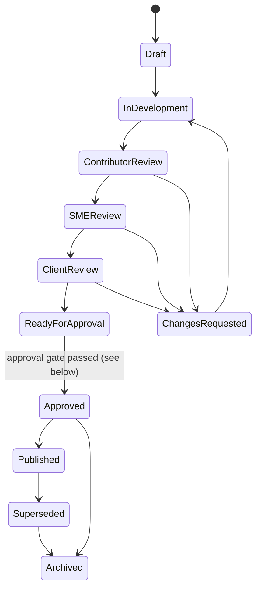

# 05 · Component 2: AI Training Content Generator

Covers master-prompt §14–§24 and §31–§32, plus §36 items 11 (AI grounding and validation) and 12 (SAP integration and screenshot options).

## Design in one paragraph

Generation is a **fixed pipeline of narrow AI steps** run by the worker, not one open-ended agent. Each step gets a typed input (only the chunks it's allowed to see, already filtered by RLS as the initiating user) and must return typed JSON. Code, not the model, does the orchestration, citation checks, and status changes. All outputs for a module come from one **instructional content model**. Each output is rendered from it, edited on its own, and versioned on its own. Nothing an AI produces becomes approved or published without humans going through the configured approval rules.

## AI grounding and validation strategy

### Which sources a job may use

A chunk is eligible for a job only if **all** of these hold. They are checked in SQL, as the initiating user, at retrieval time:

1. The user can read the asset (RLS: scope, membership, audience, work grants).
2. `ai_use` is `generation` (may be incorporated) or `reference` (may only validate or compare), or it's `human_approval_required` **and** an `ai_use_authorizations` row covers this job or module.
3. `approval_status = approved`, unless the user explicitly adds a draft as "reference only, label as unvalidated".
4. `lifecycle_status = active`. Superseded and expired versions are only used if a human explicitly adds them, and they are labeled.
5. The asset's classification is within the model provider's ceiling and the client's allowed providers (gateway check).

### Authority order and conflicts

The §14 order is stored as `authority_tier` on each asset:

| Tier | Source |
|---|---|
| 1 | Approved Client-Specific sources |
| 2 | Evidence from the client's configured system (later phase) |
| 3 | Approved Client-Specific test scripts |
| 4 | Authorized Shared/Restricted sources |
| 5 | Approved Dassian documentation |
| 6 | Approved SAP documentation |
| 7 | Approved government-contracting / regulatory references |
| 8 | Approved reusable organizational training |
| 9 | Administrator-approved external references |
| 10 | AI-generated supplemental content |

Tier is a *default*, not an automatic winner. The Validating Sources step compares facts across sources (steps, field requirements, rules) and creates a **conflict** whenever two eligible sources disagree, with both citations. It never quietly picks one. Conflicts are resolved by an **SME reviewer** (your decision), who chooses a side or writes the correct version and records why. The resolution is stored and reused in later jobs on the same sources. Special cases that always become a conflict instead of a tier decision:
- the higher-tier source is older than its next-review date or near expiry,
- the lower-tier source is regulatory or contractual (tier 7) and touches compliance content,
- the sources name different system versions.

Unresolved conflicts don't stop drafting. The affected blocks are generated with a **Conflict** label and both options. But an output can't be **approved** while it has an unresolved conflict.

### Provenance labels

Every block in the content model carries one label (§14) and its citations:

| Label | Meaning | Shown to reviewers as |
|---|---|---|
| `client_provided` | Taken from tier 1 or 3 sources | Client source |
| `system_extracted` | From the client system (later) | System evidence |
| `reference` | From SAP, Dassian, regulatory, or shared sources | SAP/Dassian reference |
| `ai_generated` | Connecting or explanatory text written by the model, no client facts | AI-generated |
| `needs_validation` | Supplemental content proposed to fill a gap | Requires human validation |
| `conflict` | Sources disagree | Conflict: choose |
| `missing` | Required information not found anywhere | Missing information |

**Rule enforced in code:** a block describing a client process step must be `client_provided`, `conflict`, `needs_validation`, or `missing`. The QA step rejects any client process step labeled `reference` or `ai_generated`, which is how "never silently replace Client-Specific steps with generic steps" is enforced.

### Citation verification

The model returns citations as chunk ids. Code then checks that:
- each cited chunk was actually in the job's eligible set (anything else is dropped and flagged),
- content from `reference`-mode sources appears only in validation notes, not in learner-facing text,
- the block's text is supported by the cited chunk (lexical overlap and key-term match: transaction codes, field names, and numbers in the block must appear in the cited text). Weak support downgrades the block to `needs_validation`.

### Gap handling (§14 sequence)

When the Gap Analysis step finds a required element missing (a step without navigation, a field without a rule, an objective without content), it searches client, then shared, then SAP/Dassian sources. It then either fills the gap with a cited `needs_validation` block or, if nothing is found, inserts a `missing` block. Either way it creates a review task routed to the module's SME reviewer.

## Pipeline: steps and the §31 agents

| Job status (§19) | Step | §31 agent(s) | Output |
|---|---|---|---|
| Queued | – | – | – |
| Ingesting Sources | Make sure every selected asset version is scanned, extracted, and embedded | Source Intake | Ready chunk set |
| Extracting Content | Build a process model: steps, roles, decisions, inputs, outputs, exceptions, navigation | Process Analysis | `process_model` JSON with citations |
| Validating Sources | Compare the process model with SAP and Dassian references and client config; list conflicts | SAP Validation, Dassian Validation | Conflicts, validation notes |
| Analyzing Gaps | Readiness re-check; gap search; questions for the user | Gap Analysis | Gaps, `needs_validation` proposals; may move to **Awaiting User Input** |
| Capturing Screens | Match steps to screenshots in the client's screenshot library; placeholders where none exist | Screenshot | Screenshot assignments (MVP: selection only, no capture) |
| Generating Content | Objectives, sequencing, explanations, practice → instructional model; then each requested output | Instructional Design → Job Aid, Presentation, Assessment, HTML Course | Model version + output versions |
| Performing Quality Review | Citations, labels, terminology (client glossary), completeness against output templates, accessibility | Quality Assurance, Accessibility | Findings attached to the output versions |
| Completed / Completed with Warnings / Failed / Canceled | Write Generation Manifests; notify | – | Drafts in the editing workspace |

The Publishing agent runs later, at publication, not during generation.

**Why not autonomous agents?** Each step is auditable (its inputs and outputs are stored), can be retried by itself, and is cheap to test with fixtures. The model never chooses which data to fetch, so it can't reach beyond the permission-filtered set. Tool-using agents can be added inside a step later, with the same input boundary, if they turn out to help.

**Prompt templates** are versioned files. The manifest records each template's version, the provider, and the model.

## Training Readiness

Per module, recalculated when its sources change and at the start of every job.

| Factor (§15) | Evidence |
|---|---|
| Process documentation | Approved client source covering the module's process |
| Roles | Business roles mapped to the module |
| Test scripts | Approved test script for the process |
| Client terminology | Glossary entries for the module's workstream |
| SAP references | Approved SAP/Dassian reference for the transactions/apps |
| Screenshots | Approved screenshots for extracted steps |
| Business rules | Rules/exceptions extracted |
| Learning objectives | Objectives defined on the module |
| Approval status | Share of selected sources approved |
| Source currency | Share of selected sources current |
| Unresolved conflicts | Count |

Each factor is configured per client as **blocks**, **warns**, or **ignored**. Status is decided in this order, so it's always explainable:

1. Any *blocking* factor missing → **Generation Blocked**.
2. No approved client process source at all → **Insufficient Information**.
3. Unresolved conflicts, or any source still needing SME sign-off → **SME Validation Required**.
4. Any *warning* factor missing → **Source Gaps Identified**.
5. All present, but some sources are reference-only or need-validation content would be produced → **Ready with Review Required**.
6. Otherwise → **Ready**.

The percentage shown next to the status is the same weighted formula as coverage, with weights, missing items, and calculation date displayed.

## Outputs (MVP)

All outputs use the **RevTech house template with the client's logo and colors** (your decision). Client-uploaded masters come later. All are English, with a `language` field kept for later.

| Output | Built as | Exports | Key rules |
|---|---|---|---|
| Job Aid | Structured document (title, purpose, role, prerequisites, app/transaction, inputs, numbered steps, key fields, decisions, warnings, expected result, troubleshooting, help, version, approval status, screenshots) | DOCX, PDF (from HTML), HTML | One to two pages; QA warns if longer |
| PowerPoint | Slide list from the model, with sections per §20B | PPTX | Native text, tables, and images (no flattening); **speaker notes on every slide**, enforced by QA |
| Assessment | Item bank + settings | Platform assessment; included in HTML/SCORM | Default 10 items. Types: MC, multiple response, T/F, matching, sequencing, scenario. Every item cites its source and objective. **If fewer than 10 can be supported, it generates fewer and warns**, rather than padding with unsupported questions. |
| Interactive HTML | Course JSON for the course player | Platform course, Standalone HTML zip, SCORM 1.2 zip | Same instructional coverage as the deck; patterns: module menu, progress, objectives, tabs, accordions, tooltips, click-to-reveal, zoomable and hotspot screenshots, knowledge checks, scenarios, final assessment, completion page, references, job-aid download, accessibility controls |

Interaction patterns are original code. RevTech Hub is a functional reference only, unless ownership of its components is confirmed (open question).

### One model, many outputs, controlled synchronization

- Each output version records the model version it was rendered from.
- Editing an output changes **only that output** and creates a new output version.
- From an edited output, a Contributor can choose **"Propose change to the shared model"**. That creates a new model version (recorded in the manifest).
- Other outputs then show *"Content model changed since this version: review differences"*, with a block-level diff, and offer **Re-render** (creates a draft version) or **Dismiss**. Approved outputs are never overwritten.

## Editing workspace

- Structured editing per output: blocks, steps, slides (with notes), assessment items. Not a free-form canvas. Rich text uses TipTap.
- Track changes: every save records a block-level diff into `manifest_events`. Compare any two versions; restore creates a new version, never a rewrite.
- Citations are editable: a Contributor can re-point or remove a citation, and removing all citations from a client step relabels it `needs_validation`.
- Round-trip: uploading an edited DOCX or PPTX is supported as **"Upload revised file"**. The file is attached as a new output version with `origin = reuploaded`, its text is diffed against the previous version for reviewers, and relationships are kept. Re-parsing an arbitrary edited file back into the structured model is not attempted in the MVP.

## Review and approval

- **Approval gate:** all approval rules met, no open required comments, no unresolved conflicts, and the accessibility check passed or waived.
- Which review stages apply is configurable per client and output type (for example, internal-only content may skip Client Review).
- Reviewers anchor comments to blocks/text ranges, with category, priority, and required/optional. Comment states follow §22. Only the reviewer who raised a required comment (or a Client Training Administrator) can mark it **Verified**.
- **Approval rules** (§32) match on client, workstream, output type, process, risk class, and destination. These items always need a named human approval: client process steps, financial-transaction content, contract guidance, compliance statements, security instructions, production screenshots, sensitive data, assessment answer keys, publication, and LMS push.
- Notifications go to assigned Contributors and Client Training Administrators, in-app for the MVP. Email comes later.

## Change-impact analysis

The knowledge side finds affected output versions and blocks ([04-knowledge-management.md](04-knowledge-management.md#change-detection-input-side-of-change-impact-analysis)). The generator side then:
1. Shows each impacted output with its affected blocks highlighted and the source diff next to them.
2. Routes it to the output owner. They mark **No change needed** (recorded with a reason) or start a new draft version, optionally re-running only the affected steps.
3. Keeps the prior approved version and all learner records unchanged.
4. Lets a Client Training Administrator or LMS Administrator stop the old version from receiving **new** assignments and flag **retraining required**, which re-enrolls completed learners on the new version.

## SAP integration and screenshot options

| Option | How it works | Pros | Cons | Fit |
|---|---|---|---|---|
| **Manual capture + annotation (MVP)** | Contributors take screenshots in the client's non-production system and upload them into the screenshot workspace: crop, annotate, number steps, redact (burned in), link to steps | No SAP connectivity, credentials, or licensing; works for every client | Manual effort | MVP |
| Browser automation (Playwright) against Fiori Launchpad | Worker drives a browser through an approved test script with a non-production technical user; screenshots at marked steps; auto-redaction of configured fields | Fiori is web-based; full control; reuses our Chromium | Needs network path to client systems, a client-approved identity, and handling of SAP GUI for HTML quirks | Phase 4 candidate |
| SAP-native test automation (eCATT/CBTA, or the client's existing tool such as Tricentis Tosca) | Reuse the client's existing automated tests and export their screenshots | Already approved by client IT; no new automation identity | Depends on what each client has; export formats vary | Import adapter, per client |
| SAP Build Process Automation | SAP's RPA records and replays | SAP-supported | Licensing per client; not designed for documentation capture | Unlikely |
| SAP Enable Now import | Import existing Enable Now simulations and screenshots | Many SAP customers already have them | Import only, no new capture | Import adapter, later |

For any automated option, the §18 pre-run checklist (environment, identity, authorization, test data, apps, data-changing steps, cleanup, screenshot points, sensitive fields) becomes a required form. A dry run is mandatory, unattended production runs are blocked, and steps with financial, contractual, procurement, workforce, inventory, security, or regulatory consequences are refused unless the target is a sandbox the client has certified.

Screenshots from a client system default to Client-Specific / Client Confidential. Generic demo images in Global are labeled "Generic demonstration – not your configured system" wherever they appear.

## Generation journey (FI/CO demo)

Client Training Administrator in **Client Context: Meridian Aerostructures** → module "Post a General Journal Entry" shows **Ready with Review Required** (one SAP reference is reference-only) → opens the Generation wizard → keeps the defaults (Job Aid, PowerPoint, Assessment, HTML; audience: GL accountants, new to S/4HANA; 30 min; transactional emphasis) → authorizes the one "Human Approval Required" asset for this job → generates → the progress screen moves through the statuses, then **Awaiting User Input**: "Source A requires a reference document for amounts over $50,000; Source B doesn't mention it. Which applies?" → an SME answers → **Completed with Warnings** (2 steps have no screenshot) → Contributor uploads two screenshots in the annotation workspace → submits for SME Review → comments resolved → Client Review → approved per the client's approval rule → published to the platform LMS.
